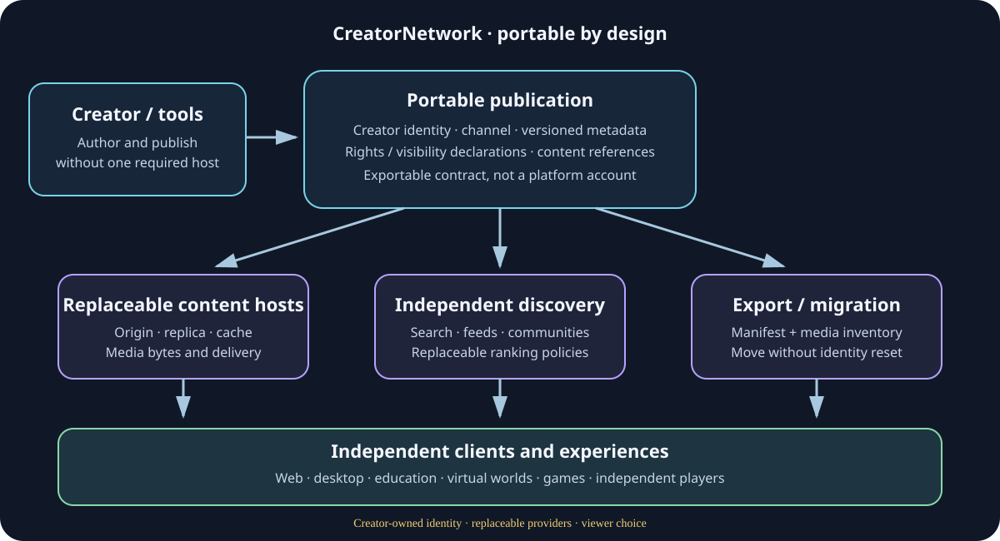

# CreatorNetwork — A creator-owned publishing network

**Creators should own their identity, publications, and audience relationships. Viewers should choose how they discover and experience them. Hosting and discovery providers should be replaceable.**

CreatorNetwork is the proposed foundation for a creator-owned internet: not another destination that asks everyone to move into one platform, but interoperable contracts and reference implementations that let independent creators publish once and reach many clients without surrendering the relationship to a single platform.

This repository is at its foundation stage. It establishes product boundaries, vocabulary, theory, and the first vertical slice before committing to a wire protocol or production media stack.

**[Start with the concept](docs/THEORY.md) · [Understand the architecture](docs/ARCHITECTURE.md) · [First vertical slice](docs/GETTING_STARTED.md) · [Documentation index](DOCUMENTATION_INDEX.md)**

## 🟣 01 — Why CreatorNetwork?

A centralized platform commonly bundles identity, publishing, storage, discovery, recommendations, audience relationships, monetization, and playback. That is convenient, but makes creators dependent on one platform’s policies, reach, and continued existence.

CreatorNetwork separates those concerns:

- **Creator-owned identity:** identity is not merely an account at one hosting provider.
- **Portable publications:** channels and manifests reference content without tying it to one app.
- **Replaceable hosting:** content can move or replicate without rebuilding creator identity.
- **Independent discovery:** clients and communities choose discovery and recommendation policies.
- **Many manifestations:** one publication can appear in a website, desktop application, educational experience, virtual environment, or independent player.
- **Composable meaning:** MicroBundles compose meaning by reference, not duplication. Reusable content should be referenced rather than copied into every experience.

This is infrastructure for platform choice, not a claim that protocols alone solve economics, legal obligations, moderation, or distribution.

## 🟦 02 — What is the system?

At the center is a portable publication: creator identity, channel or collection, versioned metadata, and references to media or other content. Independent services may store, replicate, index, recommend, or deliver those publications. Clients decide how to present them.

The publication contract is the portable center. Storage, discovery, delivery, and presentation are providers around it—not a single mandatory platform.

## 🩵 03 — Where it fits in The Singularity Workshop

| Component | Responsibility |
|---|---|
| **CreatorNetwork** | Creator identity boundaries, publication contracts, portable references, permissions, discovery interfaces, migration/export. |
| [MicroBundleDomain](https://github.com/TrentBest/TheSingularityWorkshop.MicroBundleDomain) | Domain contracts for independently meaningful MicroBundles. CreatorNetwork may reference this model where it fits; it does not redefine it. |
| [FSM_COS](https://github.com/TrentBest/TheSingularityWorkshop.FSM_COS) | Resolves and assembles runtime capabilities for a host. It is not the creator registry, media host, or recommendation authority. |
| Experiences and application hosts | Demonstrate and present publications; they consume CreatorNetwork contracts rather than own the network. |
| Media/storage providers | Store, replicate, transcode, and deliver media through replaceable provider boundaries. Executable artifact storage and media delivery remain distinct concerns. |

**Core principle:** the creator owns the publication boundary; providers implement replaceable services; clients choose how to manifest the result.

## 🟢 04 — See it in a minute

The first proof is intentionally smaller than a social network:

1. Create a stable creator identity.
2. Publish a channel manifest with metadata and a reference to one media item.
3. Serve the publication from a local or HTTPS-backed Creator Node.
4. Discover and render it from a separate client.
5. Export the publication and move it to another host without changing creator identity.
6. Consume the same publication from a separate Experience without hardcoding its content.

The first implementation should prove portability before optimizing scale. Local storage and ordinary HTTPS are enough for the first slice; replication, adaptive streaming, caches, and peer-to-peer delivery can follow evidence rather than precede it.

See [Getting Started](docs/GETTING_STARTED.md). Until runnable code exists, these are implementation goals—not claims that the workflow is already implemented.

## 🟪 05 — Build the open network

- **Understand the why:** [Theory](docs/THEORY.md).
- **Understand ownership and boundaries:** [Architecture](docs/ARCHITECTURE.md).
- **Follow the first proving path:** [Getting Started](docs/GETTING_STARTED.md).
- **Review protocol choices:** [Interoperability](docs/INTEROPERABILITY.md).
- **Understand trust limits:** [Security and Trust](docs/SECURITY_AND_TRUST.md).
- **Contribute deliberately:** [Development](docs/DEVELOPMENT.md) and [Documentation Index](DOCUMENTATION_INDEX.md).

Keep the portable contract layer dependency-light. Provider-specific integrations belong behind explicit interfaces and must not force every creator or client to use the same vendor.

---

## Resources & Support

- **Source:** [CreatorNetwork on GitHub](https://github.com/TrentBest/TheSingularityWorkshop.CreatorNetwork)
- **The Singularity Workshop:** [GitHub profile](https://github.com/TrentBest) · [Coder Legion](https://coderlegion.com/user/The%2BSingularity%2BWorkshop)
- **Community:** [Coder Legion](https://coderlegion.com/)
- **Support:** [Patreon](https://www.patreon.com/c/TheSingularityWorkshop) · [PayPal](https://www.paypal.com/donate/?hosted_button_id=3Z7263LCQMV9J)

---

<!-- THE SINGULARITY WORKSHOP FOOTER -->

