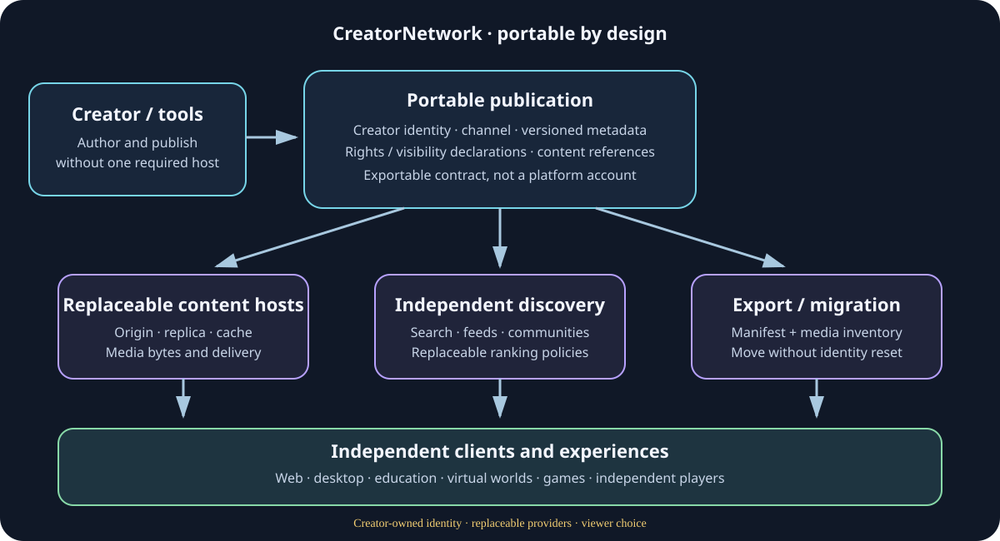

# CreatorNetwork — The Content Creator platform

**Creators should own their identity, publications, and audience relationships. Viewers should choose how they discover and experience them. Hosting and discovery providers should be replaceable.**

CreatorNetwork is The Singularity Workshop's creator-facing **Content Creator platform**: the environment through which creators bring together tools, devices, services, media, data, simulations, MicroBundles, and Experiences to originate and distribute work that does not have to fit a conventional social-media format. Its portable contracts and trust plane let that work move across compatible clients and providers without making one editor, runtime, hosting provider, discovery service, or aggregator the owner of the creator's work or audience relationships.

CreatorNetwork coordinates with the Workshop's specialist domains rather than reimplementing them: StoryBuilder owns canonical story authoring; Experiences owns Experience composition and finalization; UserIO and host adapters own interaction and source acquisition; MicroBundleDomain owns capability meaning; MicroBundleRepository owns immutable artifact retrieval; FSM_COS owns runtime composition; and clients/hosts own presentation and execution policy. CreatorNetwork connects finalized outputs through channel/publication identity, provenance, rights and sharing declarations, portable references, discovery/addressing, and migration.

**Current implementation:** the repository contains v1 channel contracts, additive v2 separated channel/publication snapshot contracts, provenance and scoped-rights declarations, source-approved representation references, validation tests, a runnable in-memory museum-consumer contract demonstration, a loopback-only file-backed Creator Node prototype, a host-neutral .NET authoring client for recorded-media upload and explicit publication, named performance benchmarks, and a source-integrated Profiles publication adapter with focused tests. The v2 contracts are not yet wired into the Node or a provider-backed publisher/consumer flow. The default Node policy is loopback-only and is not production authentication or private-audience enforcement. CI passed on [commit `f26abc6`](https://github.com/TrentBest/TheSingularityWorkshop.CreatorNetwork/commit/f26abc632271dcd61a7b7a82466ec1cc32712028): [CreatorNetwork CI](https://github.com/TrentBest/TheSingularityWorkshop.CreatorNetwork/actions/runs/45755130931) and [Sith Policy](https://github.com/TrentBest/TheSingularityWorkshop.CreatorNetwork/actions/runs/45755130920). The manual BenchmarkDotNet execution was skipped. Independent provider-backed publisher/consumer applications, full export/import, and production trust enforcement remain unproven.

**[Start with the concept](docs/THEORY.md) · [Understand the architecture](docs/ARCHITECTURE.md) · [Publication contracts](docs/PUBLICATION_CONTRACTS.md) · [First vertical slice](docs/GETTING_STARTED.md) · [Local media assets and authoring client](docs/MEDIA_ASSETS.md) · [Creator studio, capture, and streaming](docs/CREATOR_STUDIO_AND_STREAMING.md) · [Profiles integration](docs/PROFILES_INTEGRATION.md) · [Provenance and rights-aware representations](docs/PROVENANCE_AND_REPRESENTATIONS.md) · [Museum representation consumer sample](samples/CreatorNetwork.MuseumConsumer/README.md) · [Documentation index](DOCUMENTATION_INDEX.md)**

## 🟣 01 — Why CreatorNetwork?

A centralized platform commonly bundles identity, publishing, storage, discovery, recommendations, audience relationships, monetization, and playback. That is convenient, but makes creators dependent on one platform’s policies, reach, and continued existence.

CreatorNetwork separates those concerns:

- **Creator-owned identity:** identity is not merely an account at one hosting provider.
- **Portable publications:** channels, Experiences, and typed resources can be referenced without tying them to one app or hosting provider.
- **Replaceable hosting:** content can move or replicate without rebuilding creator identity.
- **Independent discovery:** clients and communities choose discovery and recommendation policies.
- **Many manifestations:** one publication can be experienced through a website, desktop application, educational experience, virtual environment, or independent player.
- **Cross-platform creation:** creators can combine tools, devices, media, services, data, simulations, MicroBundles, and interactive environments to invent forms of expression beyond today's platform-specific post formats.
- **Composable meaning:** MicroBundles compose meaning by reference, not duplication. Reusable content should be referenced rather than copied into every experience.
- **Traceable creative lineage:** provenance records distinguish real-world subjects, logical works, exact source files, modifiers, and derivatives. Lineage is an assertion to verify—not proof of ownership or permission.
- **Granular reuse:** rights declarations are scoped to exact resources and explicit actions. Cache, replication, transformation, redistribution, and commercial use are not implied by display permission.
- **Creator independence:** creators can move their work between compatible providers and clients. Discovery and aggregation are optional services, not owners of creator content or audience relationships.

This is infrastructure for platform choice, not a claim that protocols alone solve economics, legal obligations, moderation, or distribution.

## 🟦 02 — What is the system?

At the center is a stable creator-owned channel containing immutable, versioned publication snapshots. A snapshot references a finalized Experience artifact and typed supporting resources without owning their bytes. The authoring and composition domains create the work; CreatorNetwork coordinates creator publication and distributes portable references. Independent services may store, replicate, index, recommend, or deliver those publications. Clients declare their capabilities and decide how to present compatible work.

The publication contract is the portable center. Storage, discovery, delivery, and presentation are providers around it—not a single mandatory platform.

## 🩵 03 — Where it fits in The Singularity Workshop

| Component | Responsibility |
|---|---|
| **CreatorNetwork** | Creator-facing Content Creator platform; portable channels/publications, provenance and rights/sharing declarations, source-approved representation references, discovery/addressing, and migration. |
| [StoryBuilder](https://github.com/TrentBest/StoryBuilder) | Canonical story records, narrative authoring, scenes, beats, timelines, and story provenance. |
| [Experiences](https://github.com/TrentBest/TheSingularityWorkshop.Experiences) | Reusable Experience definitions, composition, validation, and finalization. |
| [Profiles](https://github.com/TrentBest/TheSingularityWorkshop.Profiles) | Shared domain semantics for entities, claims, relationships, and observer-specific disclosure. CreatorNetwork carries only an approved publication-safe projection. |
| [UserIO](https://github.com/TrentBest/FSM_UserIO) | Source-neutral semantic interaction; host-owned adapters acquire devices and handle OS permissions. |
| [MicroBundleDomain](https://github.com/TrentBest/TheSingularityWorkshop.MicroBundleDomain) | Domain contracts for independently meaningful MicroBundles. CreatorNetwork references them through Experience artifacts; it does not redefine them. |
| [MicroBundleRepository](https://github.com/TrentBest/TheSingularityWorkshop.MicroBundleRepository) | Immutable MicroBundle/Experience artifact storage and retrieval through replaceable providers. |
| [FSM_COS](https://github.com/TrentBest/TheSingularityWorkshop.FSM_COS) | Resolves and assembles runtime capabilities for a host. It is not the creator registry, media host, or recommendation authority. |
| Media/storage providers and application hosts | Store, replicate, deliver, render, and execute under their own provider and host policies. |

**Core principle:** CreatorNetwork is the Content Creator platform; its specialist Workshop domains remain authoritative for their own authoring, capture, artifact, composition, and presentation responsibilities.

## 🟢 04 — See the current proof

The current code proves important parts, not the complete platform:

1. Validate provider-neutral provenance, rights, and representation declarations.
2. Model a stable channel separately from immutable publication revisions.
3. Reference a finalized Experience artifact by identity, version, and digest.
4. Reference non-executable supporting resources without pretending they are MicroBundles or media storage.
5. Run an in-memory museum consumer that selects a source-approved representation for a requested action.
6. Exercise the local v1 Creator Node and its host authorization/conditional-write seams.

The v2 contract models and tests pass in the [latest CI run](https://github.com/TrentBest/TheSingularityWorkshop.CreatorNetwork/actions/runs/45755130931). The default Node remains loopback-only. A provider-backed independent publisher/consumer, two-provider export/import, and production identity/rights/sharing enforcement are the next proof—not claims about the current implementation.

## 🟪 05 — Build the open network

- **Understand the why:** [Theory](docs/THEORY.md).
- **Understand ownership and boundaries:** [Architecture](docs/ARCHITECTURE.md).
- **Understand v1/v2 channel and publication contracts:** [Publication Contracts](docs/PUBLICATION_CONTRACTS.md).
- **Understand source lineage, museum-approved representations, and rights boundaries:** [Provenance and rights-aware representations](docs/PROVENANCE_AND_REPRESENTATIONS.md).
- **Follow the first proving path:** [Getting Started](docs/GETTING_STARTED.md).
- **Integrate profile identity and disclosure safely:** [Profiles Integration](docs/PROFILES_INTEGRATION.md).
- **Upload and retrieve a local recorded-media asset:** [Local Media Assets](docs/MEDIA_ASSETS.md). This prototype is loopback-only and not production-secure.
- **Understand authoring, capture, recorded media, and live-stream boundaries:** [Creator Studio, Capture, and Streaming](docs/CREATOR_STUDIO_AND_STREAMING.md).
- **Review protocol choices:** [Interoperability](docs/INTEROPERABILITY.md).
- **Understand trust limits:** [Security and Trust](docs/SECURITY_AND_TRUST.md).
- **Measure performance:** [Performance](docs/PERFORMANCE.md).
- **Contribute deliberately:** [Development](docs/DEVELOPMENT.md) and [Documentation Index](DOCUMENTATION_INDEX.md).

Keep the portable contract layer dependency-light. Provider-specific integrations belong behind explicit interfaces and must not force every creator or client to use the same vendor. Performance improvements should be measured against stable workloads, with allocations and end-to-end latency considered alongside throughput.

---

## Resources & Support

- **Source:** [CreatorNetwork on GitHub](https://github.com/TrentBest/TheSingularityWorkshop.CreatorNetwork)
- **The Singularity Workshop:** [GitHub profile](https://github.com/TrentBest) · [Coder Legion](https://coderlegion.com/user/The%2BSingularity%2BWorkshop)
- **Community:** [Coder Legion](https://coderlegion.com/)
- **Support:** [Patreon](https://www.patreon.com/c/TheSingularityWorkshop) · [PayPal](https://www.paypal.com/donate/?hosted_button_id=3Z7263LCQMV9J)

---

<!-- THE SINGULARITY WORKSHOP FOOTER -->

